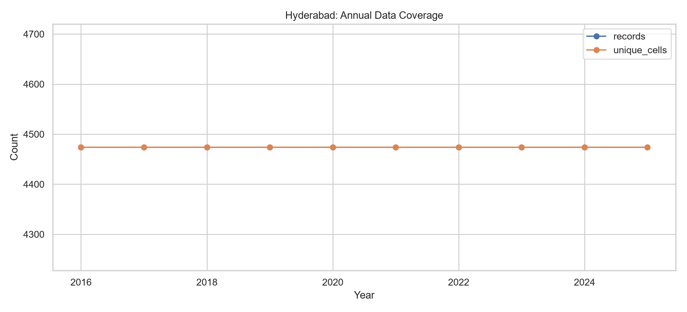
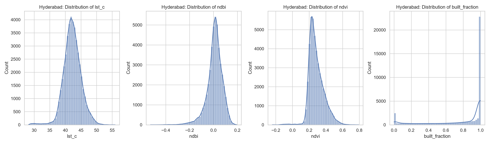
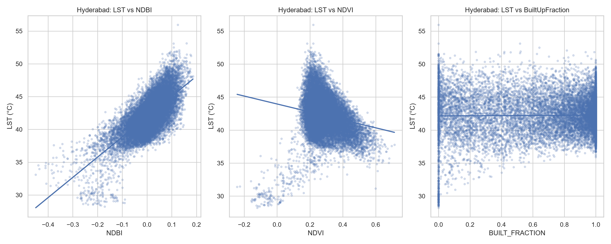
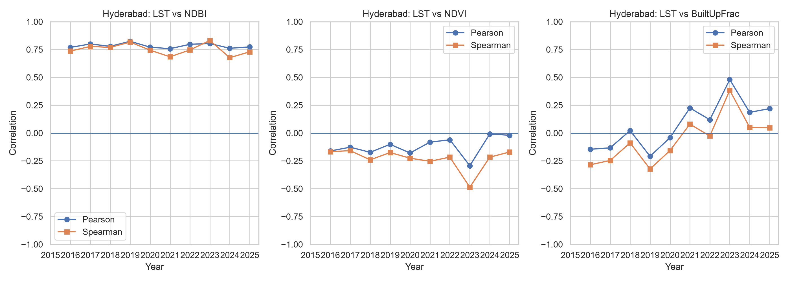
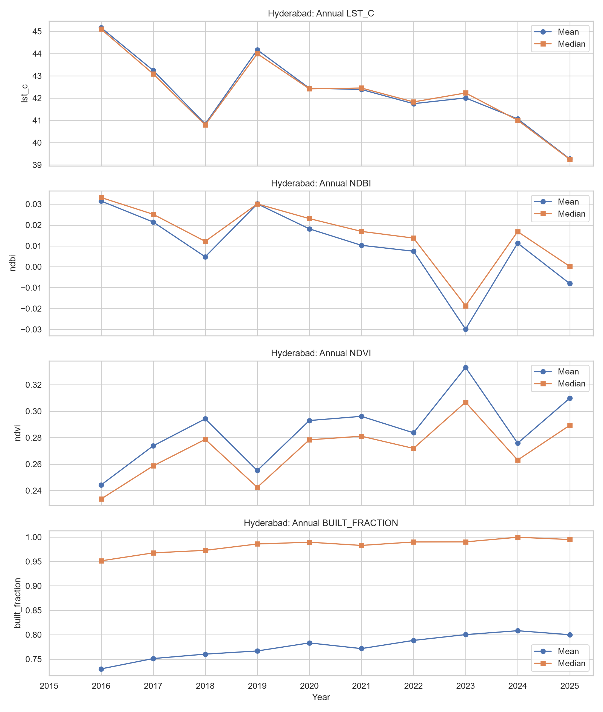

# Urbanization–Heat Research: Progress Report

*Research-status summary. Emphasis on Hyderabad, the only city with built-up data analysis so far.*

## 1. Research question and design

**Question.** How does the relationship between urban built-up intensity and land surface temperature (LST) vary across Indian cities, and to what extent does vegetation modify this relationship through nonlinear effects and potential thresholds?

**Design (as proposed).** Seasonal (March–June) Landsat 8/9 composites, 2015–2025, aggregated to 300 m grid cells over each city plus peri-urban buffer. Dependent variable: seasonal-mean LST (°C). Main predictor: built-up intensity (spectral NDBI, plus Dynamic World built-up fraction where available). Moderator: vegetation density (NDVI). Planned modeling: linear baseline → Generalized Additive Models with NDBI–NDVI interaction → explicit change-point/threshold estimation with uncertainty → cross-city validation. All findings at this stage are **associational and descriptive**; no causal claims and no threshold estimates yet.

**Study cities.** Delhi, Kolkata, Chennai, Bengaluru, Hyderabad — chosen for contrasting urban form and climate.

## 2. Data assembled

- **Thermal/spectral panel (all five cities).** One row per grid cell per year, 2015–2025: `lst_c`, `ndvi`, `ndbi`, observation counts, sensor mix (Landsat 8 throughout; Landsat 9 from its operational period). Per-city merged files live in `data/regions/`; a pooled quality-controlled file (`data.csv`) was produced by the first EDA notebook.
- **Spatial framework.** 300 m grids in equal-area projection with stable `grid_id`s, one shapefile per city in `grids/`. Earth Engine scripts in `gee/` cover boundary-plus-buffer definition, grid construction, temporal sampling, and the LST/NDVI/NDBI extraction pipeline.
- **Independent built-up data.** Dynamic World–derived `built_fraction` (fraction of cell classified built-up), 2016–2025, currently on disk for **Hyderabad and Delhi**. Only Hyderabad's has been merged and analyzed.

## 3. Quality control (pooled, all cities)

The first EDA pass (`notebooks/1_eda.ipynb`) checked year coverage, missingness, plausibility ranges (LST 0–80 °C; NDBI/NDVI within [−1, 1]), out-of-range values, and cross-city distributions (boxplots; per-city/annual summary tables), then wrote the cleaned pooled dataset. This established that the thermal panel is sufficiently complete and plausible to support descriptive analysis in every city.

## 4. Hyderabad — the completed case study

Hyderabad (`notebooks/2a_hyd_eda.ipynb`, outputs in `series2_outputs/hyderabad/`) is the only city where the thermal panel has been joined to the independent built-up series. Because Dynamic World starts in 2016, the merged Hyderabad analysis covers **2016–2025**.

### 4.1 Sample

- 4,474 grid cells × 10 years = **44,740 cell-year records**, balanced panel (same cells every year).
- Zero missing values on `lst_c`, `ndbi`, `ndvi`, `built_fraction`, `n_obs_mean` after the merge.
- Mean valid observations per cell-year range from ~4 to ~11 across years — adequate for seasonal composites, with year-to-year variation worth carrying as a control.

### 4.2 How Hyderabad changed, 2016–2025 (annual means)

| Year | Mean LST (°C) | Mean NDBI | Mean NDVI | Mean built_fraction |
|------|--------------|-----------|-----------|--------------------|
| 2016 | 45.2 | 0.031 | 0.244 | 0.730 |
| 2018 | 40.8 | 0.005 | 0.294 | 0.760 |
| 2019 | 44.2 | 0.030 | 0.255 | 0.767 |
| 2023 | 42.0 | −0.030 | 0.333 | 0.800 |
| 2025 | 39.3 | −0.008 | 0.310 | 0.800 |

Three descriptive facts stand out. First, **mean built-up fraction rose from ~0.73 to ~0.80**, i.e. continued densification of an already heavily built landscape — the **median cell is ~0.95–1.00 built-up in every year**, so the distribution is strongly left-skewed with a ceiling effect. Second, **annual mean LST fluctuates substantially** (roughly 39–45 °C) with no monotonic warming trend in the seasonal mean — interannual climate variability appears to dominate the city-wide average. Third, **2023 is anomalous on vegetation**: mean NDVI jumps to 0.33 with doubled spread, coinciding with the most negative mean NDBI (−0.03); any 2023-specific result should be checked for a sensor/composite or monsoon-timing artifact before being trusted.

### 4.3 Finding 1 — LST tracks spectral built-up intensity strongly and stably

Pooled across all Hyderabad cell-years, **LST–NDBI Pearson r = 0.72 (Spearman ρ = 0.67, n = 44,740)**. Year by year the correlation is even tighter and remarkably stable: **r = 0.76–0.82 in every year, 2016–2025**. In substantive terms, cells that are spectrally more built-up are consistently hotter, and this association reproduces in each of ten independent annual cross-sections. This is the strongest and most robust descriptive result in the project so far and the empirical anchor for the planned nonlinear modeling.

### 4.4 Finding 2 — vegetation is weakly and unstably associated with cooling

Pooled **LST–NDVI r = −0.21 (ρ = −0.29)** — the expected sign (greener → cooler) but modest. Annual correlations range from −0.01 to −0.29 and are near zero in 2024–2025. NDBI and NDVI are themselves negatively related (pooled r = −0.39, reaching −0.57 in 2023), as expected where buildings displace vegetation. For the research question this matters: **a simple linear vegetation term will not capture much**, which motivates the planned interaction analysis (does NDVI matter more at particular NDBI levels?) rather than assuming a uniform cooling effect.

### 4.5 Finding 3 — the Dynamic World built-up fraction disagrees with NDBI, and that disagreement is informative

Pooled **LST–built_fraction r ≈ 0.01** — essentially zero, in sharp contrast to the LST–NDBI result. Annually, the sign flips: negative/weak 2016–2020 (−0.21 to +0.02), then positive from 2021, peaking at **r = 0.48 in 2023** before settling near +0.2 in 2024–2025.

This discrepancy does not overturn Finding 1; it qualifies what each measure captures, and it is arguably the most important methodological result so far:

- **Ceiling/saturation.** With the median cell already ~100% built-up, `built_fraction` has little room to vary where most Hyderabad cells sit, compressing its gradient exactly where the LST gradient is steepest.
- **Construct difference.** NDBI is a continuous spectral property of the surface (exposed soil, concrete, roofing all contribute); Dynamic World `built_fraction` is a classified share. They need not agree, and the analysis shows they do not substitute for one another mechanically.
- **Instability over time.** The 2021 sign change and 2023 spike (a year already flagged as vegetatively anomalous) warn against pooling built-up effects across years without testing temporal stability — directly relevant to the project's stability criterion for any future threshold claim.

**Bottom line for Hyderabad.** The heat–built-up association is strong and reproducible when built-up intensity is measured spectrally (NDBI); it is weak and year-dependent when measured as classified built share; vegetation shows a weak average cooling association. None of this yet demonstrates nonlinearity or a threshold — that requires the GAM and change-point stages, which have not been run.

### 4.6 Hyderabad figures and tables produced

Distributions of all four variables; LST-vs-NDBI/NDVI scatterplots with fits (20,000-point sample); pooled and annual Pearson/Spearman tables (now including `built_fraction` pairs); annual mean/median trend plots; annual correlation-trajectory plots (including LST-vs-built_fraction); choropleth maps for 2016, 2020, 2025; plus `annual_summary_statistics.csv`, `missing_values.csv`, and the correlation tables.

